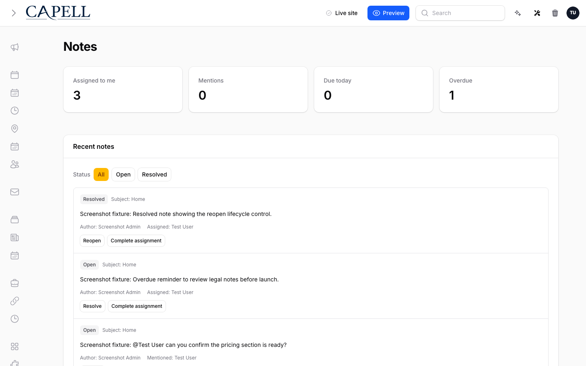

# Notes

<!-- prettier-ignore-start -->

## What It Does

Notes adds private record notes with assignments, mentions, reminders, completion state, and an inbox for work needing attention.

- **Price and availability:** Check current availability and price on the [Capell Marketplace listing](https://capell.app/extensions/notes).
- **Licence:** Check the licence terms on the [Capell Marketplace listing](https://capell.app/extensions/notes).
- **Requires:** `PHP ^8.4`, `capell-app/admin ^1.0.66`, `capell-app/core ^1.0.75`.
- **Install:** `composer require capell-app/notes`.

Admin users can add a note from supported records, assign colleagues, mention people, set reminders, and work through their Notes inbox.

## Who It Is For

**For developers:** Note creation, visibility, assignment, reminders, and notifications are split into Actions behind a reusable Notes manager.

**For teams:** Editors can coordinate follow-up beside the record being discussed without exposing internal notes on the public site.

## Quick Start

1. Install the package: `composer require capell-app/notes`.
2. See it working: run `php artisan capell:notes-demo`.
3. Open the package admin surface at `/admin/notes` and confirm Notes is available.

## Configure

- **Configuration files:** `config/capell-notes.php`.
- **Commands:** `php artisan capell:notes-demo`, `php artisan capell:notes:send-due-reminders`.

## Limits And Pitfalls

- Install the required Capell packages at the versions in `composer.json`: `capell-app/admin ^1.0.66`, `capell-app/core ^1.0.75`.
- Run migrations before opening package resources or public routes.
- Keep the host Laravel scheduler running so package-registered schedules can execute: `capell:notes:send-due-reminders (everyFiveMinutes; package registered)`.

## Screens And Workflow

- User-menu notes item with attention badge (admin).
- Notes inbox page (admin).
- Record-level Add note modal (admin).
- Empty notes inbox state (admin).
- Notes inbox with assigned, mentioned, and lifecycle controls (admin).
- Notes inbox page with admin sidebar menu open (admin).

## Install Impact

- Required packages: `capell-app/admin`, `capell-app/core`.
- Admin navigation: declares `admin-page: NotesAdminPageContribution`; each Filament page or resource controls its own navigation visibility.
- Admin/editor extensions: `admin-action-extender: NotesAdminActionExtenderContribution`.
- Permissions: `View:Note`, `Resolve:Note`, `Reopen:Note`, `CompleteAssignment:Note`; access also governed by package policies: `NotePolicy`.
- Public routes: none declared.
- Database changes: package migrations are declared.
- Config: `config/capell-notes.php`.
- Settings: no package settings declared.
- Queues or schedules: scheduled commands `capell:notes:send-due-reminders (everyFiveMinutes; package registered)`.
- Cache tags: none declared.
- Commands: `capell:notes-demo`, `capell:notes:send-due-reminders`.

## Troubleshooting

| Symptom | Likely cause | Check | Fix |
| --- | --- | --- | --- |
| Package surface is missing after install | Provider or manifest is not loaded | Confirm `capell.json`, package `composer.json`, and provider registration | Reinstall the package, refresh Composer autoload, and clear host caches |
| Admin screen or command fails on missing table | Package migrations have not run | Check the tables listed in `Data Model` | Run host migrations and rerun the focused package test |
| Background work does not run | Queue worker or declared schedule is not active | Check the jobs and scheduled commands listed in `Technical Shape` | Start the queue worker or host scheduler, then run the focused command or package test |

## Upgrading

No manual steps between minor versions.

Read [CHANGELOG.md](CHANGELOG.md) before upgrading.

## Next Steps

- [Package docs](docs/README.md)
- [Overview](docs/overview.md)
- [Admin guide](docs/admin-guide.md)
- Configuration files: [`config/capell-notes.php`](config/capell-notes.php).
- [Troubleshooting](#troubleshooting)
- [Developer reference](docs/reference.md)
- [Marketplace assets](docs/assets/marketplace/)
- [Capell content language plan](../../docs/CONTENT_LANGUAGE_PLAN.md)
- [Capell documentation design system](../../docs/DESIGN_SYSTEM.md)
- [Capell and package ERD notes](../../docs/erd/capell-and-package-erds.md)

<!-- prettier-ignore-end -->
