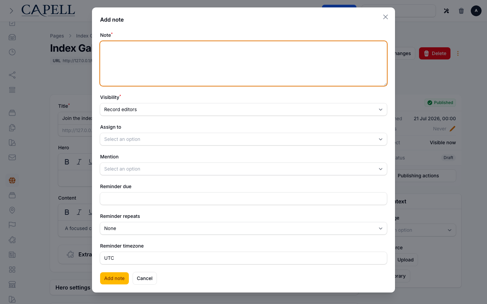
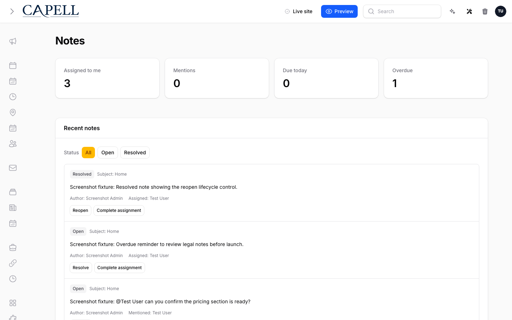
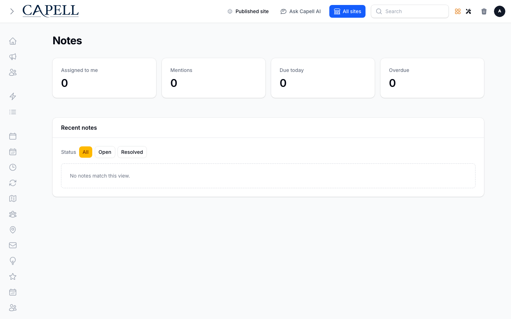

# Using Notes

This guide is for teams who leave private notes inside the admin: editors flagging things on records, and the people who pick those notes up. No technical knowledge needed. Every step uses the labels you see on screen. Notes are internal only - visitors to your site never see them.

## Using Notes (how-to)

### How to add a note to a record

1. Open the record you want to comment on (for example a page) so its edit screen is showing.
2. Click **Add note** in the header.
3. Type your message in the **Note** field.
4. Set **Visibility** to choose who can see it: **Private** keeps it to you and the people you involve, while **Record editors** shares it with everyone who can edit that record.
5. If someone should own the note, pick them under **Assign to**.
6. To pull someone's attention to it without assigning it, choose them under **Mention**.
7. Save the note.

### How to assign a note and mention people

1. While adding a note, use **Assign to** to give it an owner. Assigned people see it in their inbox and are notified.
2. Use **Mention** to flag people who should be aware of the note but do not own it. Mentioned people are notified too.
3. Save the note. The people you assigned or mentioned will find it waiting in their **Notes** inbox.

### How to set a reminder on a note

1. Under **Assign to**, select at least one editor with record access. Select yourself for a personal reminder. Set **Reminder due** to the date and time in the chosen **Reminder timezone**.
2. To make it repeat, choose a value under **Reminder repeats** such as **Daily**, **Weekly**, **Monthly**, or **Yearly**. Leave it on **None** for a one-off reminder.
3. Enter a valid IANA zone, such as `Europe/London`, under **Reminder timezone**. The inbox shows the next local time and UTC instant. Delayed scheduler runs preserve the intended cadence.
4. Save the note. Active assignees with record access receive the reminder when it is due. If it is marked unsent, review it in **Notes** and ask your administrator to restore access or update the assignment and reminder through the integration that created it. The inbox has no assignment or reminder editor; no recipient-less occurrence is counted as notified.

### How to find notes that need your attention

1. Open **Notes** from the main navigation, under the **Extensions** group. It is also available from your account menu in the top corner, where a badge shows how many notes need you.
2. The inbox gathers notes that involve you: those **Assigned to me**, your **Mentions**, items **Due today**, and anything **Overdue**.
3. Use the **Status** filter at the top to switch between **All**, **Open**, and **Resolved** notes, or select an attention filter. Use **Previous** and **Next** to reach older notes; full instructions appear on each note.

### How to resolve, reopen, and complete notes

1. Open **Notes** and find the note in the inbox.
2. When a note is dealt with, click **Resolve** to close it off. Resolve/Reopen appear only for the author or an active assignee.
3. If a resolved note needs more work, click **Reopen** to bring it back to open.
4. For a note that was assigned to you, click **Complete assignment** once you have finished your part.

### How to read an empty inbox

1. Open **Notes**.
2. If you see a message that no notes match the view, nothing needs your attention right now.
3. Switch the **Status** filter to **All** to confirm there are no notes hiding under another status.

## Rolling out Notes (for owners)

Owners must follow the [reminder deployment and rollback runbook](deployment.md) before enabling new or replacement reminders. If these are temporarily unavailable, contact the administrator responsible for the rollout.

### Turn on first

- Notes on records and the inbox. This is the whole package: adding notes, assigning them, and clearing them from the inbox. Get your team adding notes on a few records, then introduce reminders.

### Add when needed

| Need                                           | Use                                                            |
| ---------------------------------------------- | -------------------------------------------------------------- |
| Hand a note to a specific person               | **Assign to** when writing the note                            |
| Make someone aware without giving them the job | **Mention** when writing the note                              |
| Not forget a follow-up                         | **Reminder due**, with **Reminder repeats** for recurring ones |
| Keep a note tightly held                       | **Visibility** set to **Private**                              |

### Who does what

| Role       | First useful screen                                                     |
| ---------- | ----------------------------------------------------------------------- |
| Editor     | A record's edit screen: click **Add note** to flag something            |
| Note owner | **Notes** inbox: pick up assigned notes and mentions, then resolve them |

## Troubleshooting

| What you see                            | What it means                                                           | What to do                                                                                     |
| --------------------------------------- | ----------------------------------------------------------------------- | ---------------------------------------------------------------------------------------------- |
| A note will not save                    | The **Note** field is empty or the text is too long                     | Enter some text and keep it within the length the message states                               |
| A note I expected is not in my inbox    | It was not assigned to or mentioning you, or its status is filtered out | Switch the **Status** filter to **All**; check it lists you under **Assign to** or **Mention** |
| The inbox says no notes match this view | Nothing needs your attention under the current filter                   | Switch the **Status** filter to **All** to see everything                                      |
| A badge shows on the account menu       | Some notes are assigned to you, mention you, or are overdue             | Open **Notes** and work through them                                                           |
| I worry a note is visible to visitors   | It is not; notes are internal to the admin only                         | Nothing to do - visitors never see notes                                                       |
| A reminder did not surface              | The reminder time has not been reached yet                              | Check the **Reminder due** time on the note                                                    |
